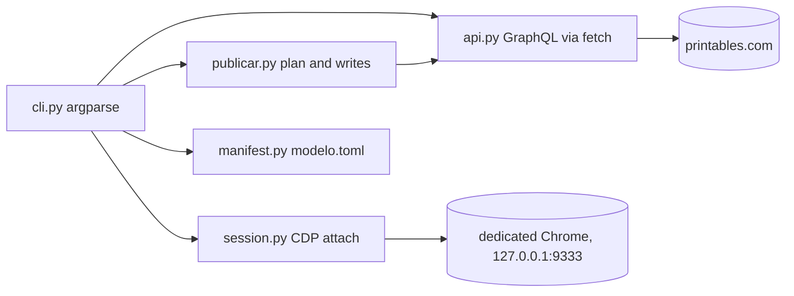
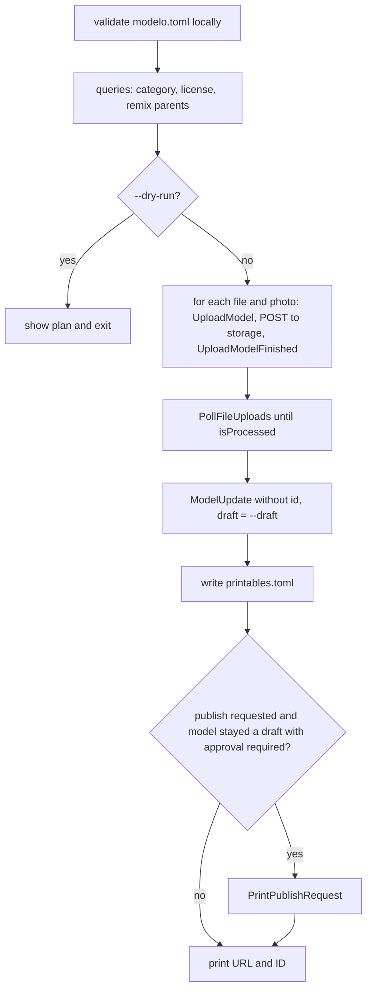

# Design

## Goal and scope

Manage your own Printables models from the command line: log in, list, download, publish and update. Single user, single account.

In scope: session check, listing your models, downloading the files of a model, publishing from a folder, updating description, files and photos. Out of scope: comments, collections, statistics, contests, messages, deleting models.

## Architecture

- `session.py`: checks the CDP port, can launch the dedicated Chrome, attaches with Playwright `connect_over_cdp`.
- `api.py`: GraphQL client executed with `fetch` inside a Printables tab of that Chrome. Reads, download links, signed uploads and `modelUpdate`.
- `publicar.py`: resolves category, license and remix, builds the plan and runs `publish` / `update` through the API.
- `manifest.py`: loads and validates `modelo.toml` and converts `descripcion.md` to HTML.
- Source of truth for a model: Printables. Source of truth for the design: your own project folder.

## Decisions

| ID | Decision |
|---|---|
| D01 | Python 3.12 + uv + Playwright. |
| D02 | Commands: `login`, `whoami`, `list`, `download`, `publish`, `update`. |
| D03 | `publish` publishes by default; `--draft` leaves the model as a draft. |
| D04 | The password never goes through the CLI. The user logs in by hand; the session lives in the Chrome profile `~/.config/printables-cli/chrome` (mode 700). |
| D05 | Everything goes through the internal GraphQL API, run with `fetch` inside a logged-in tab. Operations are copied from the web app JS into `operaciones.json` (introspection is disabled). |
| D06 | A model is described by `modelo.toml` in its folder; the description is a separate Markdown file. |
| D07 | Cloudflare blocks browsers launched by automation, so the CLI attaches over CDP to a normal Google Chrome opened by the user. No evasion techniques: the user logs in and passes any verification by hand. |
| D08 | `publish` and `update` write through the same GraphQL calls as the web form (`printFileUpload2`, storage upload, `printFileUploadFinished`, `modelUpdate`); the form itself is not automated. See `API.md`. |
| D09 | `update` never removes files or photos already on Printables: it only adds or replaces by name. `update --publish` publishes a reviewed draft. |
| D10 | With `remix_de`, the license must be one Printables allows for the parent license; the CLI refuses before uploading. |

## Flows

### publish

Errors: invalid manifest, unknown category or license, license incompatible with the remix parent: exit code 2, Printables untouched. API failure: exit code 4; if it failed before `ModelUpdate` no model exists (loose uploads expire by themselves) and `publish` can be repeated; if it failed after, `printables.toml` already exists and you continue with `update <id>`.

### update

`ModelEditDetail` of the model, start from the full current listing, apply only the requested sections (`--description` = title, summary, description, category, tags, license and remix; `--files`; `--photos`; no flags means all three), then `ModelUpdate` with `id`. Files with the same name and size are not uploaded; same name and different size are uploaded and replace the old one; everything else is kept. Photos are appended by file name when missing. `--publish` saves with `draft: false`.

### download

Resolve the ID from the URL, ask the API for the file list, fetch each file, write `fuente.toml`. A file that returns 403/404 is reported and the rest continue; exit code 4 if none was downloaded.

## Output and exit codes

Human output by default, `--json` on `whoami`, `list`, `publish` and `update`. Exit codes: 0 ok, 2 usage or manifest, 3 no session, 4 Printables failure.

## Risks

Printables can change the web app or the internal API. Operations are isolated in `operaciones.json` and `api.py`; the reverse-engineered flow is in `API.md`.
